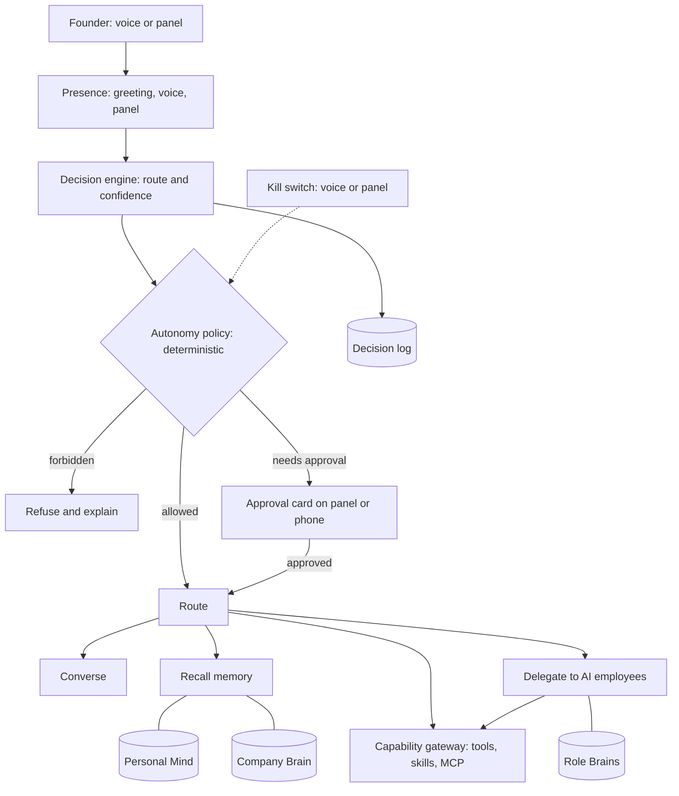

# Vision: SamJuniorsOS as an AI company

Captured 2026-10-20 from the founder. Everything here is TARGET unless a line says it exists. If this file disagrees with `AGENTS.md`, `PRODUCT.md` or `doc/ROADMAP.md`, those win: open a finding and do not build the disputed part.

## 1. In the founder's words (verbatim, spelling kept)

> "when I open my voice agent screen appear and greet me she should have personal memory and company memory so if I ask something she should respond normaly like I m talking to real person if I ask about company she should talk about company and if I need any info she use company memory so we need a decession engine who decide what to do"

> "if I have product she should take over that product from building to managing to marking to customer support etc every thing so she need aubagents or ai employed whom she manage also ai employ have there own personal and memory to like real team"

> "we should have tools and skills and mcps so we can increse the power of company thing a real company in form of ai"

> "as shopia is ceo take references from the research we created and apply in app with filling gaps"

> "Ok I will use it for just my self but we can make it scalable so we can increse many founder later donot implement"

> "Yes pc off or on as we are handling on cloud as well as desktop both"

> "I donot know yet daily model spend can adjust from settings"

> "Start with option 1 yes first product take over by sofia but yes for future we can use paperclip onboarding"

Earlier, same project: controlling the Windows PC by voice "like real Jarvis"; voice first, with the desktop panel as the fallback; web and Android later.

## 2. Requirements and where they are built

| ID | Requirement | Gates |
|---|---|---|
| V1 | Opening the app shows the screen and Sofia greets the founder | G6.6 |
| V2 | One persona that talks naturally about anything, like a person | G6.7, G6.1 to G6.3 |
| V3 | Personal memory | G11 |
| V4 | Company memory, used for company questions and information needs | G11, G12.3 |
| V5 | A decision engine that decides what to do | G12 |
| V6 | A team of AI employees Sofia manages, each with its own memory | G13, G11.5 |
| V7 | Takes over a product: build, operate, market, support | G15 |
| V8 | Tools, skills and MCP servers that extend the company | G14 |
| V9 | Everything persists across restarts and shutdowns | G2, G11.7 |
| V10 | For the founder only now; built so more founders can be added later; no multi-founder feature built | G0.1 (decided), G2.7, Q-SCALE-1 |
| V11 | Voice control of the Windows PC | G7 |

## 3. What exists today and what does not (checked 2026-10-20)

Exists in the working tree: a personal-memory store whose new memories stay inactive until the founder confirms them; the Company Brain substrate (Source, Signal, Claim, Fact, Memory); a closed four-role workforce (COO Sophia Vance, Researcher, PM, Finance); executive council deliberation; a decision store; approval binding to the exact payload; an intent classifier with seven kinds including `conversation`; streaming speech-to-text, voice-activity gating, push-to-talk and a transcript view.

Not found (searched `src`): an MCP client, a skills loader, a tool gateway, a product object, per-employee memory. Whether anything greets on open is NOT VERIFIED (G6.6 starts by checking). On a plain checkout the COO's live replies depend on z-ai credentials, so without them replies fall back to deterministic text (observed 2026-10-15; code unchanged since; G1.5 re-checks).

## 4. Blueprint

Every input takes the same path. The model proposes a route. A deterministic policy engine decides whether it runs, needs the founder's approval, or is forbidden. Tools are reached only through the gateway. Every decision is logged. The kill switch stops everything.

## 5. Design rules

1. **One brain, many roles.** Sofia is the CEO of the AI company and its single orchestrator (founder, 2026-10-20). The founder is the owner and keeps final authority (`AGENTS.md`); CEO is a role inside the AI company, not authority over the founder. The repository still names the role COO (Sophia Vance, id `coo`) until G0.4 decides. Employees are scoped workers, not independent minds (`AGENTS.md`: realtime is not a second Sophia; `PRODUCT.md`: no uncoordinated swarms). The decision engine extends the existing classifier; it is not a second router.
2. **A team, not a swarm.** Reported evidence (Anthropic's multi-agent research write-up, June 2025): an orchestrator with parallel workers beat a single agent by 90.2% on its internal research eval, at roughly 15 times the tokens of a chat; Anthropic also says tasks needing shared context or many dependencies, such as coding, fit multi-agent systems poorly, and Cognition argues for single-threaded agents. So: parallel workers for breadth work (research, drafts, triage); one thread for building. Every delegation has a budget.
3. **Memory stays partitioned.** The Personal Mind and the Company Brain stay separate (`PRODUCT.md`). Sofia reads either only through the router and can say which scopes an answer used. Employees never read the Personal Mind. Personal facts enter company artifacts only by the founder's explicit act. A Role Brain is never company truth.
4. **Authority is deterministic.** Models propose; code decides. The OWASP Agent Control Standard (v0.1 preview, Sept 2026) describes the same idea as hooks and a policy authority; treat it as a design reference, not a dependency.
5. **Autonomy is earned and per domain.** Self-improving is not self-authorizing (`PRODUCT.md` section 8). Raising a level is a recorded founder decision backed by evaluation evidence.
6. **Hiring is a founder decision per employee**, with demonstrated need (`PRODUCT.md`). One employee at a time, each evaluated before the next.
7. **Third-party code is untrusted until vetted.** Skills, tools and MCP servers pass the vetting pipeline (G14.4). Malicious skills have been reported on community hubs.
8. **Stop always works.** "Stop" by voice and the panel button halt autonomous action, even with the model provider down (G12.7).
9. **Honesty.** Never invent a memory, an activity or a result. "I do not remember" is a valid answer. Voice can propose, never approve.
10. **Scale later, build now for one.** Keys carry an owner scope and no code assumes exactly one human, but no multi-founder feature is built (G2.7).

## 6. Autonomy ladder

| Level | Meaning |
|---|---|
| L0 | Observe and report only |
| L1 | Propose; the founder performs the action |
| L2 | Act after the founder approves this specific action |
| L3 | Act within stated limits, then report |
| L4 | Act and report only exceptions |

Recommended starting levels by action class. These are a recommendation; G0.7 decides.

| Action class | Examples | Start |
|---|---|---|
| Read | search, recall, summarize | L3 |
| Draft | plans, posts, replies | L3 |
| Internal write | tasks, notes, code on a branch | L2 |
| External, reversible | calendar entries, scheduled drafts | L2 |
| External, hard to reverse | publish, message customers, deploy to production | L2, always approval at first |
| Financial or legal | spend, refunds, contracts | L1 until caps are set |
| Destructive or security | delete data, change permissions or credentials | Founder only |

## 7. Memory scopes

| Scope | Founder | Sofia | Employee | Notes |
|---|---|---|---|---|
| Personal Mind | all | read and write; writes need the founder's confirmation | none | Existing confirm-first flow |
| Company Brain | all | read; writes via the verified pipeline | read through a projection | Provenance required |
| Role Brain | read | read | own only | Derived from the Company Brain; never company truth |
| Session and episodic | all | read and write | own task only | Consolidated into semantic memory; deletable |

Only confirmed or verified items are recalled as fact. Deletion removes derived copies too.

## 8. Decision routes

| Route | When | Memory scopes | Side effects |
|---|---|---|---|
| converse | chat on any topic | personal, as relevant | none |
| recall-personal | about the founder | personal | none |
| recall-company | about the company | company | none |
| research | needs outside information | company, tools | read |
| use-tool | a specific tool action | per tool | per policy row |
| delegate | work for an employee | company projection | per policy row |
| schedule | later or recurring | company | per policy row |
| ask-clarify | low confidence or ambiguity | none | none |
| propose-for-approval | needs a decision | as needed | none until approved |
| refuse | forbidden or unsafe | none | none |

## 9. Employees

Today's roster is the COO, Researcher, PM and Finance. A natural roster for running a product adds an Engineer (builder), a Marketer, a Support agent and an Ops agent, later possibly Sales and Design. This is a recommendation for G0.6, not a decision. Each employee has a charter, tools, a budget, a Role Brain, an evaluation record and version history, supervised by Sofia.

## 10. Acceptance scenarios (measurable criteria set in G16.1)

- **A1 Greeting.** Opening the app shows the screen and Sofia speaks a greeting using only real state; with no state she greets plainly.
- **A2 Natural conversation.** A multi-turn chat on any topic feels natural, correctly refers to something from an earlier session, and invents nothing.
- **A3 Company question.** A question about the company is answered from the Company Brain with its sources; a planted personal fact does not appear.
- **A4 Needs information.** A question that needs research makes the engine pick the research or tool route, use the gateway, cite sources, and leave an audit record.
- **A5 Delegation.** "Have the marketer draft X" gives a structured result with evidence from the employee's own Role Brain; the decision log and cost are recorded.
- **A6 Product takeover, supervised.** Over the pilot period the build, operate, market and support playbooks each complete at least one real cycle, with approvals where required and outcomes measured.
- **A7 Control.** The kill switch halts everything within the founder's time limit; voice cannot approve; instructions injected through a web page, ticket or tool output cannot trigger an unapproved action.
- **A8 Continuity.** After a restart, a redeploy and a day off, memory is intact and pending work resumes.
- **A9 Windows control.** On a real Windows machine, read-only inspection works, then an approved write action works.

## 11. Research notes (confidence labelled)

- **Reported:** multi-agent versus single-agent figures above, from several write-ups of Anthropic's June 2025 post (I did not open the original) and Cognition's reply.
- **Verified (OWASP pages):** Top 10 for Agentic Applications published 2025-12-09; LLM Top 10 2026 edition published 2026-08-03; Agent Control Standard donated September 2026 as a v0.1 preview. A secondary source lists the agentic categories as ASI01 to ASI10 including goal hijacking, tool misuse, identity and privilege abuse, and cascading multi-agent failures.
- **Reported:** Agent Skills is an open SKILL.md format published December 2025 and adopted by about 40 platforms by mid-2026 (counts vary by source); 341 malicious skills were found on community hubs by February 2026 (one source).
- **Verified earlier this session:** the stable MCP spec revision 2026-07-28 removed persistent sessions. Re-check at implementation time (G14.2).
- **Unknown:** whether customers must be told they are dealing with an AI, which varies by place. A qualified person must review it (G15.6).

## 12. Ecosystem scan (GitHub and GitLab, 2026-10-20): reuse, borrow or build

Method and limits: web search only. Claims come from project pages and comparison sites, which disagree (star counts differ by up to 25%). Nothing was installed or run. Maturity and security of every project are NOT VERIFIED. Rule: before building a commodity part, the ADR for that step compares the named candidates and records borrow, adopt or build. The default is to borrow ideas and not adopt a second brain, store or engine (`AGENTS.md`), unless the founder approves an ADR.

| Area | What exists (reported) | Proposal | Gates |
|---|---|---|---|
| Personal agent with memory, skills and channels | **OpenClaw** (open source; gateway over messaging apps; file-based memory with consolidation; a 3,000+ skill registry; a skills supply-chain incident in Feb 2026 and an RCE CVE in Jan 2026 were reported). **Hermes Agent** (Nous Research; self-improving; memory plus external memory plugins) | Study, do not adopt as the runtime. Borrow bounded memory files, consolidation, and skills that agents propose and the founder reviews | G11, G14.3 |
| Company orchestration | **Paperclip** (MIT): org chart, per-agent monthly budgets, approvals, budget hard-stops, pause, resume, terminate, heartbeat, company templates, multi-company isolation. Several clones exist | Study before G13.1. Borrow hard-stops, pause and terminate, role templates. Adopting it is a second orchestration engine. Its isolation model informs the scale-later seam | G13.1, G13.2, G2.7 |
| Memory | **Mem0**, **Graphiti** (temporal graph, facts with valid-from and invalidation, MCP server), **Letta** (a whole agent runtime), **Cognee** (graph) | No second store. Borrow time-aware facts and supersession, and background consolidation. Adopt only behind a memory interface if the G11.3 benchmark shows a gap | G11.1, G11.3, G11.4 |
| Voice | **Pipecat** (BSD-2) and **LiveKit Agents** (Apache-2.0): turn detection and barge-in built in; neither ships memory or observability. Both are Python-first | Evaluate before building barge-in. Weigh a Python sidecar against the TypeScript core. Keep the decision engine in the core | G6.1, G6.2 |
| Action governance | **Latch**, **AgentLedger**, **AgentPolicy**, **JamJet** and similar: policy returns allow, block or approve; rolling per-agent budgets; tamper-evident audit; replay. All are small and young | Do not adopt. The repo already has payload-bound approval, idempotency and side-effect audit. Borrow budgets and hash-chained audit | G12.4, G3.6, G13.4 |
| Autonomous coding | **OpenHands** (MIT): sandboxed engine for coding agents, with an SDK | Candidate engine for the Engineer employee, inside its sandbox, single-threaded | G15.3, G13.7 |
| GitLab | **Duo Agent Platform** (documented on docs.gitlab.com; paid Premium or Ultimate tiers): custom agents, flows, a versioned AI Catalog of agents, flows and MCP servers, MCP client and server, a self-hosted option | Not usable as a base (tied to GitLab, paid). Borrow the versioned catalog with group controls. This search found no notable community "AI company" project on GitLab, which may be a gap in the search | G14.1, G13.2 |
| Skills and tools | **Agent Skills** (SKILL.md, agentskills.io); **MCP** (spec 2026-07-28) | Adopt both formats behind the gateway; community skills untrusted | G14.2, G14.3 |
| Agent workflow method | **GSD Core** (MIT, active; the link you gave is an archived redirect) and **Ponytail** (MIT rule set) | Reviewed in `capability-requests/`. Borrowed: fresh session, plan, independent verification, smallest complete change. Not installed. GSD may be trialled on one step by the founder | PROTOCOL |

**Gaps these projects leave (inference from what their pages describe, not from testing):** none of the company-orchestration projects described a voice-first persona that greets you; none described strict separation of a personal mind from company memory; none described one persona that is both a personal companion and the COO. Your differentiator is the integration of governed company knowledge, personal memory and voice presence, not any single part. Each part is commoditizing quickly, so build the integration and the governance, and reuse the commodity parts.

**Gaps in this repo (checked today by searching the code):** no hash-chained audit; no pause or kill control; no MCP client, skills loader or tool gateway; no per-employee memory; a per-agent spend cap was not identified (the word "budget" appears in council, orchestrator and context code, which suggests bounded deliberation, NOT VERIFIED). Already present: payload-bound approvals, idempotency records, scheduler heartbeat.

## 13. Biggest risks

1. **Money, publishing and customers.** The ladder, spend caps and the kill switch exist for this. Start supervised.
2. **Cost.** Teams multiply token use. Budgets are built in (G9.1, G13.4).
3. **Complexity for one maintainer.** Memory, a decision engine, a team and a capability layer is a lot. Hire one employee at a time; a gate closes only with evidence.
4. **Trust versus feeling human.** Natural conversation is the goal; inventing memories or activity is not allowed.
5. **The base is not deployable yet.** Persistence (G2) comes first.
6. **Rules in this repository.** `AGENTS.md` forbids speculative implementation and `PRODUCT.md` bounds the roster. Each gate starts only when its gate is verified and the founder authorizes it.

## 14. Decisions still needed from the founder

G0.2 (which first release), G0.3 (hosting and budget), G0.4 (one identity and the conversation provider), G0.6 (first employees and ceilings), G0.7 (autonomy limits), and later G15.1 (the pilot product).

## 15. Decisions and inputs recorded so far

- **G0.1 (2026-10-20):** internal for now, scalable later, nothing multi-founder built. `done/G0.1.json`.
- **G0.4 (2026-10-20):** Sofia's name and title, option 1: change nothing for now (Sophia and COO stay in the repository). `done/G0.4.json`.
- **Input for G0.3:** Sofia must work whether the founder's PC is on or off, so the brain runs in the cloud and the desktop is a node. Option A, D or B and the recovery targets are still open.
- **Input for G0.7:** the daily model-spend cap is not set and will be adjusted in settings. Built as G12.8; with no value set, no autonomous model spend runs.
- **Input for G0.9:** Sofia takes over the first product. The product is not yet named; the repository calls Lumora "Product 1".
- **Input for G13.1:** the founder wants to use Paperclip for onboarding employees in future. The ADR must evaluate it, including the second-engine risk.
